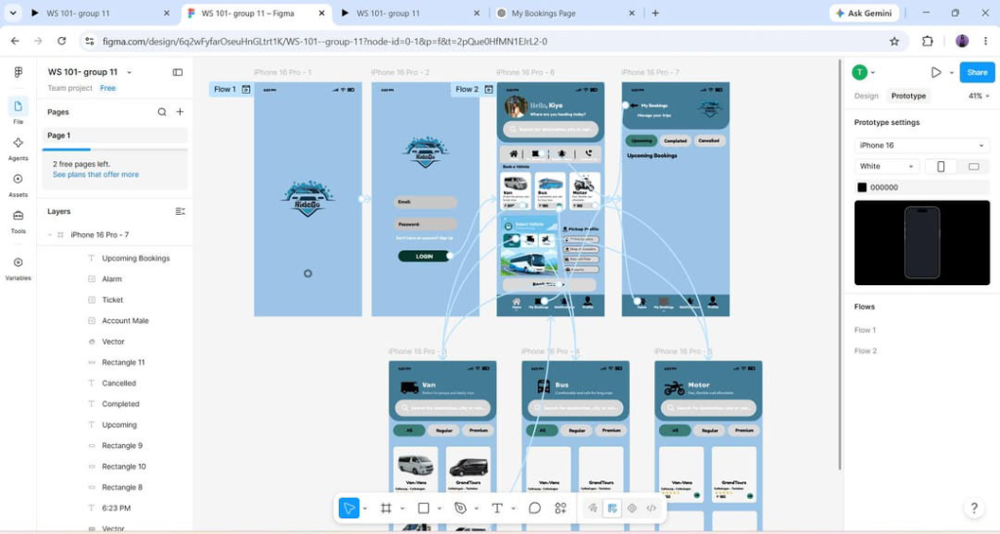
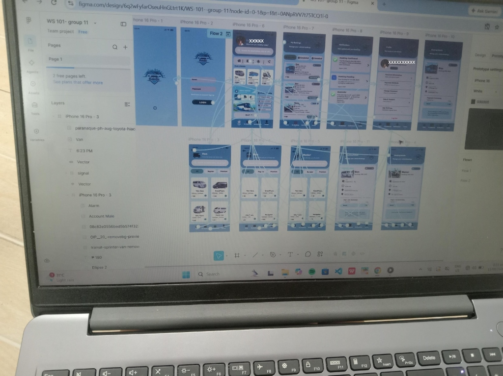
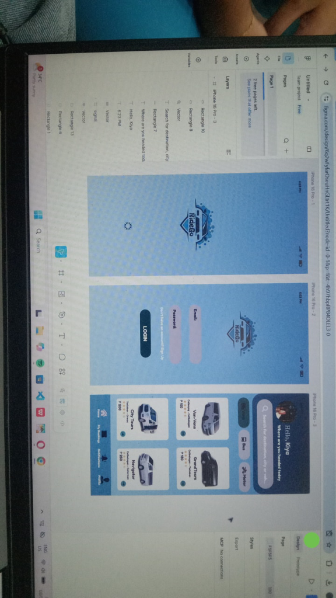
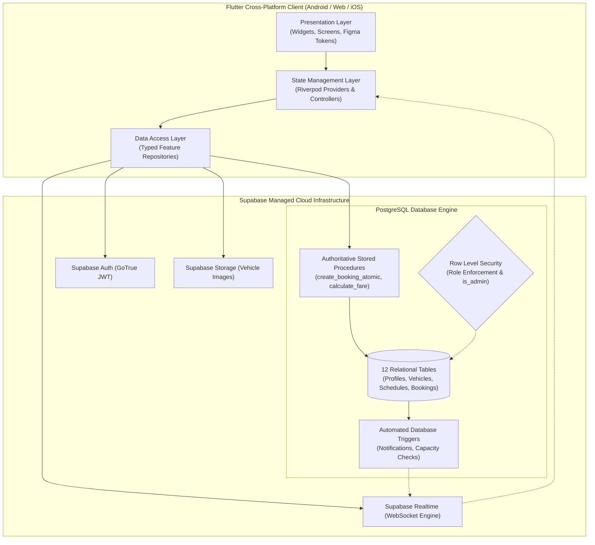
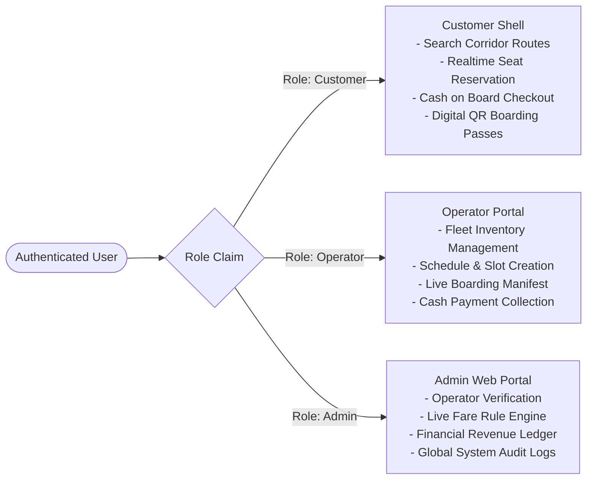
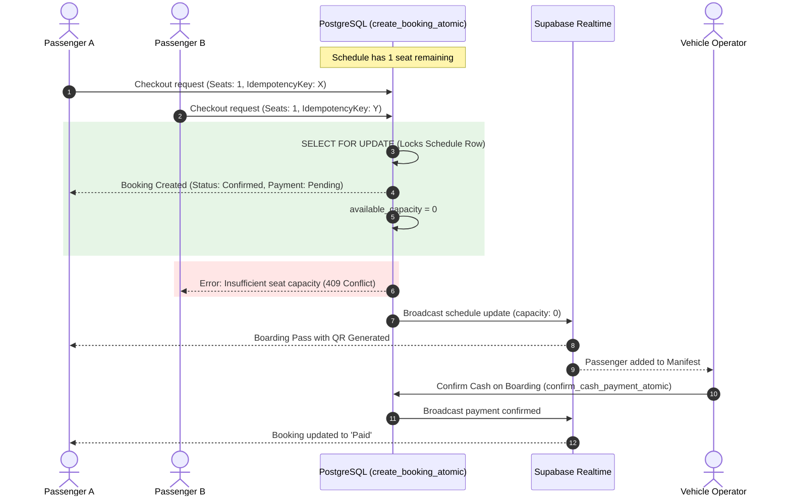

<div align="center">

# 🚗 RideGo
### Samar & Leyte Regional Transit & Vehicle Booking Platform

[](https://flutter.dev)
[](https://dart.dev)
[](https://supabase.com)
[](https://github.com/ushalabs/RideGo)
[](docs/TESTING.md)
[-success)](build/app/outputs/flutter-apk/app-release.apk)
[](#license)

**A high-concurrency, multi-tenant transportation management platform operating along the Pan-Philippine Highway (AH26) between Catbalogan City, Tacloban City, Calbayog City, and 15 intermediate municipalities in Eastern Visayas, Philippines.**

[Explore Features](#-role-based-features) • [Figma UI Showcase](#-ui--prototype-showcase) • [System Architecture](#-system-architecture) • [Getting Started](#-quick-start-guide) • [Transit Corridors](#-regional-transit-network) • [Documentation Index](#-documentation-index)

</div>

---

## 📱 UI & Prototype Showcase

RideGo was designed and implemented strictly against the authoritative Figma design system, utilizing genuine design tokens for color hierarchy, rounded card geometry, vehicle category navigation, and real-time status badges.

<div align="center">

### Figma Design & Application Flow Hierarchy
| Mobile Screen Flow & Customer Journey | Master Prototype Screen Map |
|:---:|:---:|
|  |  |
| *Flow 1 & Flow 2: Splash $\rightarrow$ Authentication $\rightarrow$ Discovery $\rightarrow$ Category Filter $\rightarrow$ Booking Manifest* | *Complete 12-Screen Multi-Role Layout Map* |

</div>

### Screen Parity Overview
<div align="center">

</div>

- **Splash Screen**: Native vector shield and bubble logo with automatic session token verification.
- **Login & Auth**: Multi-role sign-in with toggleable password visibility and customer/operator onboarding.
- **Customer Home**: Personalized greetings (`"Hello, Kiya"`), search bar, and horizontal vehicle category filters (**Vans**, **Buses**, **Motorcycles**).
- **Vehicle Catalog**: Rounded listing cards with fare badges, star ratings, and passenger capacity indicators.
- **My Bookings**: Segmented tabs (`Upcoming`, `Completed`, `Cancelled`) with scannable digital boarding passes and QR codes.

---

## 🏛 System Architecture

RideGo follows a **Feature-First Flutter Architecture** with strict layer separation, combining **Flutter Riverpod** for predictable state propagation and **Supabase PostgreSQL** as the single source of business truth.



---

## 👥 Role-Based Features

RideGo enforces strict role authorization at both the Flutter routing layer (`go_router`) and the database level (PostgreSQL RLS policies):



| Feature Area | Customer (Passenger) | Vehicle Operator | Platform Administrator |
|---|:---:|:---:|:---:|
| **Authentication & Profile** | Self-signup, profile edit | Business permit upload | Superuser bootstrap via RPC |
| **Search & Discovery** | Corridor route filtering | View assigned routes | Manage stops & corridors |
| **Fleet & Scheduling** | View active departures | Add vehicles & departures | Inspect & suspend vehicles |
| **Fare Calculation** | View calculated quotes | View seat tariffs | Live edit base & segment rates |
| **Booking & Checkout** | Cash on Board reservation | View passenger manifest | Global booking oversight |
| **Payment Confirmation** | Pending boarding pass | Confirm cash on boarding | Reconcile gross vs cash |
| **Live Notifications** | Booking confirmation alerts | New passenger alerts | System audit alerts |

---

## 🗺 Regional Transit Network

RideGo models the complete road transit infrastructure connecting Samar and Leyte across the Pan-Philippine Highway (AH26) and the San Juanico Bridge.

```
                         [ Calbayog City ] (Northern Hub)
                                ▲
                                │ Northbound Corridor (8 Segments)
                                ▼
                       [ Catbalogan City ] (Central Terminal Hub)
                                ▲
                                │ Southbound Corridor (10 Segments)
                                ▼
                        [ Tacloban City ] (Southern Hub / Leyte)
```

### Complete Stop Sequence & Intermediates
- **Southbound Corridor (`catbalogan-tacloban-south`)**:
  Catbalogan City (Terminal) $\rightarrow$ Jiabong $\rightarrow$ Motiong $\rightarrow$ Paranas (Wright) $\rightarrow$ Villareal $\rightarrow$ Pinabacdao $\rightarrow$ Calbiga $\rightarrow$ Basey $\rightarrow$ Marabut $\rightarrow$ Santa Rita $\rightarrow$ Tacloban City (Abucay Terminal).
- **Northbound Corridor (`catbalogan-calbayog-north`)**:
  Catbalogan City (Terminal) $\rightarrow$ Jiabong $\rightarrow$ Motiong $\rightarrow$ San Jorge $\rightarrow$ Gandara $\rightarrow$ Pagsanghan $\rightarrow$ Tarangnan $\rightarrow$ Santa Margarita $\rightarrow$ Calbayog City (Central Terminal).

---

## 🧮 Authoritative Pricing Engine

To eliminate client-side fare tampering, all pricing calculations execute inside the PostgreSQL RPC `calculate_authoritative_fare`:

### Piecewise Fare Formula
$$\text{Total Fare} = \left(\text{Base Fare} + \left(N_{\text{segments}} \times \text{Per Segment Rate}\right)\right) \times \text{Passengers} + \text{Terminal Fee}$$

*Where $N_{\text{segments}} = \text{Stop Order}(\text{Dropoff}) - \text{Stop Order}(\text{Pickup})$. Directionality is strictly enforced ($N_{\text{segments}} > 0$).*

### Standard Regional Fares
| Vehicle Category | Base Fare | Per-Segment Rate | Terminal Fee | Sample Trip: Catbalogan $\rightarrow$ Tacloban |
|---|:---:|:---:|:---:|:---:|
| **Van (Shared)** | ₱60.00 | ₱15.00 | ₱10.00 | **₱220.00** / passenger |
| **Bus (Air-conditioned)** | ₱45.00 | ₱10.00 | ₱5.00 | **₱150.00** / passenger |
| **Motorcycle (Charter)** | ₱40.00 | ₱20.00 | ₱0.00 | **₱60.00** (Catbalogan $\rightarrow$ Jiabong) |

---

## ⚡ Concurrency & Real-Time Engine



- **Pessimistic Locking**: `SELECT ... FOR UPDATE` acquires row-level locks on the departure schedule, mathematically preventing overselling on the last available seats.
- **Idempotency Guarantee**: Every reservation requires a client-generated UUID idempotency key, preventing duplicate bookings upon mobile network reconnects.

---

## 🧪 Quality Assurance & Test Matrix

The platform includes 30 automated tests across all operational tiers:

```powershell
$env:PATH = "C:\development\flutter\bin;$env:PATH"
flutter test
```

| Test Suite | Focus Area | Tests | Status |
|---|---|:---:|:---:|
| `test/widget_test.dart` | Smoke Testing & Splash Navigation | 1 | **Passed** |
| `test/auth_test.dart` | Supabase Auth, Roles & Privilege Escalation | 5 | **Passed** |
| `test/vehicle_route_test.dart` | Transit Corridors & Forward Sequence Ordering | 4 | **Passed** |
| `test/pricing_search_test.dart` | Dynamic Pricing Engine & Corridor Filter Queries | 7 | **Passed** |
| `test/booking_engine_test.dart` | Pessimistic Locks, Idempotency & Cash Ledger | 5 | **Passed** |
| `test/dashboard_notification_test.dart` | Analytics Aggregates & In-App Notification Center | 4 | **Passed** |
| `test/e2e_integration_test.dart` | Full End-to-End User Journeys (Passenger/Operator/Admin) | 4 | **Passed** |
| **Total Automated Suite** | **All Application Layers** | **30** | **30 / 30 Passed (100%)** |

---

## 🚀 Quick Start Guide

### Prerequisites
- [Flutter SDK](https://flutter.dev) (v3.24.0 or higher)
- Android SDK Platform 35 / Chrome (for Web)
- A Supabase Project (cloud or self-hosted)

### 1. Clone & Install Dependencies
```bash
git clone https://github.com/ushalabs/RideGo.git
cd RideGo
flutter pub get
```

### 2. Configure Environment
Create `config.dev.json` in the root folder:
```json
{
  "SUPABASE_URL": "https://YOUR_PROJECT_ID.supabase.co",
  "SUPABASE_ANON_KEY": "YOUR_SUPABASE_ANON_KEY"
}
```
*(Note: If left with placeholders, RideGo boots in high-fidelity demo fallback mode for offline testing.)*

### 3. Apply Database Migrations
Execute the migrations in sequential order in your **Supabase SQL Editor**:
1. `supabase/migrations/20261030000001_auth_and_roles.sql`
2. `supabase/migrations/20261030000002_vehicles_and_routes.sql`
3. `supabase/migrations/20261030000003_search_and_pricing.sql`
4. `supabase/migrations/20261030000004_realtime_booking_engine.sql`
5. `supabase/migrations/20261030000005_dashboards_and_notifications.sql`

To bootstrap your administrator account:
```sql
SELECT bootstrap_admin('your-admin-email@example.com');
```

### 4. Run the Application
```bash
# Launch on Mobile (Android / iOS):
flutter run --dart-define-from-file=config.dev.json

# Launch Administrator / Customer Web Portal:
flutter run -d chrome --dart-define-from-file=config.dev.json
```

---

## 📦 Deployment & Build Artifacts

- **Android Universal Release APK**:
  - Path: `build/app/outputs/flutter-apk/app-release.apk`
  - Size: `54.8 MB` (`57,467,241` bytes)
  - Install command: `adb install -r build/app/outputs/flutter-apk/app-release.apk`
- **Flutter Web Build**:
  - Path: `build/web/`
  - Hosting options: Supabase Storage (`$web`), Vercel, Firebase Hosting.

---

## 📚 Documentation Index

| Document | Purpose |
|---|---|
| [Figma Parity Guide](docs/FIGMA_PARITY.md) | Design token specifications, color palettes, and UI screen audits. |
| [System Architecture](docs/ARCHITECTURE.md) | Detailed layer architecture, state flow, and repository contracts. |
| [Database Schema](docs/DATABASE.md) | Schema definitions, table relationships, RLS policies, and RPC signatures. |
| [Route Catalog](docs/ROUTES.md) | Complete Samar and Leyte stop coordinates, corridor matrices, and fare rules. |
| [Quality Assurance](docs/TESTING.md) | Test suite breakdown, coverage benchmarks, and concurrency tests. |
| [Manual Setup Guide](docs/MANUAL_SETUP.md) | Supabase SQL Editor migration instructions, storage buckets, and realtime setup. |
| [Deployment Guide](docs/DEPLOYMENT.md) | Release APK compilation, Google Play keystores, and Web hosting. |
| [Final Acceptance Matrix](docs/FINAL_ACCEPTANCE.md) | Complete verification matrix against the 23-step acceptance scenario. |

---

## 📄 License

Proprietary — Developed for **RideGo Transportation System** (Samar and Leyte, Philippines). All rights reserved.
