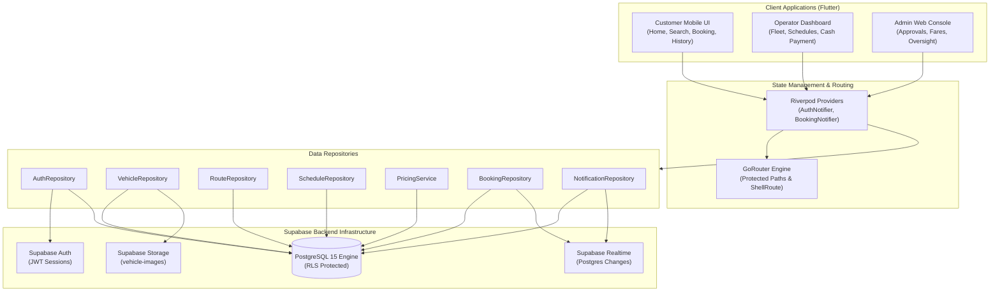

# RideGo Architecture Specification

## 1. System Overview

**RideGo** is a comprehensive multi-tenant transportation and vehicle reservation management platform engineered for the regional commuting network of **Samar and Leyte, Philippines**.

The platform serves three distinct account personas through a unified, secure codebase:
1. **Commuters / Customers** (Mobile-first Flutter interface)
2. **Transport Operators & Fleet Co-ops** (Fleet, schedule, and passenger management)
3. **System Administrators** (Flutter Web oversight console, authoritative tariffs, and approvals)

---

## 2. Technology Stack

| Layer | Component | Implementation |
|---|---|---|
| **Frontend Mobile** | Customer & Operator App | Flutter 3.47 / Dart 3.13 |
| **Frontend Web** | Admin Management Console | Flutter Web (Responsive Desktop & Tablet) |
| **Routing** | Declarative Navigation | `go_router` 14.8 with ShellRoutes |
| **State Management** | Feature State & Dependency Injection | `flutter_riverpod` 2.6 |
| **Backend & DB** | Relational Database & Realtime | Supabase PostgreSQL 15 |
| **Authentication** | Email/Password & Token Management | Supabase Auth (GoTrue) |
| **Storage** | Vehicle & Profile Photographs | Supabase Storage (`vehicle-images`) |
| **Business Logic** | Authoritative Pricing & Concurrency | PostgreSQL Stored Procedures (`SECURITY DEFINER`) |
| **Maps & Transit** | Corridor & Location Mapping | `flutter_map` with OpenStreetMap |
| **Quality Assurance** | Unit, Widget & Concurrency Tests | Flutter Test & PostgreSQL RLS Tests |

---

## 3. High-Level Architecture Diagram

---

## 4. Key Security Boundaries

1. **Client Isolation**: Client-facing mobile code never receives privileged keys (`service_role`). All operations execute under the authenticated user's JWT (`auth.uid()`).
2. **Row Level Security (RLS)**: Enforced directly at the PostgreSQL layer. A customer cannot view other commuters' booking records, nor can an operator view another operator's vehicles.
3. **Authoritative Server Pricing**: Pricing is computed via `calculate_authoritative_fare` stored procedure. Clients cannot alter calculated prices.
4. **Pessimistic Concurrency Locking**: Seat allocation executes inside `create_booking_atomic` with `SELECT ... FOR UPDATE` row locks, preventing race conditions.
5. **Role Escalation Prevention**: User roles are stored in a dedicated `user_roles` table with RLS restricting INSERT/UPDATE to verified administrators only.
