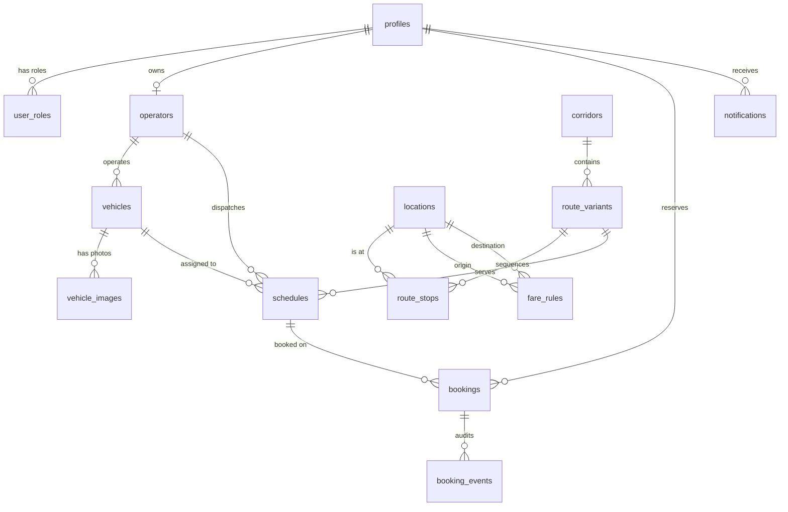

# RideGo PostgreSQL Database Architecture

## 1. Entity-Relationship Overview

---

## 2. Relational Schema & Tables

### 2.1 Identity and Access Management
- **`profiles`**: Stores full names, contact info, and profile metadata synced automatically with `auth.users` via trigger.
- **`user_roles`**: Protected server-enforced role assignments (`customer`, `operator`, `admin`). RLS strictly prohibits non-admin modification.
- **`operators`**: Transport business profiles, owner details, contact information, base terminal location, and administrator approval status (`pending`, `approved`, `rejected`).
- **`operator_applications`**: Immutable submission records for operator business reviews.

### 2.2 Transit Networks & Route Structure
- **`corridors`**: High-level transit corridors:
  - `SB_CAT_TAC`: Southbound — Catbalogan to Tacloban
  - `NB_CAT_CAL`: Northbound — Catbalogan to Calbayog
- **`locations`**: All 18 verified Samar and Leyte transit hubs, terminal locations, and major junctions.
- **`route_variants`**: Specific route patterns (e.g. Express via Maharlika Highway vs Coastal Branch via Basey & Marabut).
- **`route_stops`**: Ordered stops per route variant with explicit `stop_order`, `allow_pickup`, and `allow_dropoff` permissions.
- **`vehicle_routes`**: Operator vehicle assignments to allowed route variants.

### 2.3 Fleet & Departures
- **`vehicles`**: Operator fleet units with plate numbers, passenger capacity, category (`van`, `bus`, `car`, `motorcycle`), and status.
- **`vehicle_images`**: Vehicle photographs linked to Supabase Storage.
- **`schedules`**: Time-slotted trip departures with seat capacity tracking and status (`scheduled`, `boarding`, `in_transit`, `completed`, `cancelled`).

### 2.4 Pricing, Bookings & Real-Time Engine
- **`fare_rules`**: Authoritative tariff configurations specifying base fares, segment fees, and terminal fees.
- **`bookings`**: Commuter reservations with human-readable references (`RG-2026-XXXX`), idempotency keys, seat allocations, itemized fare snapshots, and payment statuses.
- **`booking_events`**: Immutable audit log tracing all reservation lifecycle events.
- **`notifications`**: User-scoped in-app notifications with read/unread tracking and real-time subscription support.

---

## 3. Server Stored Procedures (`SECURITY DEFINER`)

### 1. `create_booking_atomic(...)`
- Performs pessimistic locking on the schedule row: `SELECT * FROM schedules WHERE id = p_schedule_id FOR UPDATE`
- Verifies idempotency key to prevent duplicate booking submissions
- Enforces seat capacity check at database level
- Decrements available seats atomically
- Creates booking record and audit trail in a single ACID transaction.

### 2. `cancel_booking_atomic(...)`
- Locks booking and schedule rows
- Verifies authorization (owner, assigned operator, or admin)
- Re-increments schedule capacity safely
- Transitions status to `cancelled` and writes audit event.

### 3. `confirm_cash_payment_atomic(...)`
- Verifies actor is an authorized operator or administrator
- Records cash payment receipt date and staff user ID
- Updates status to `confirmed` and `paid`.

### 4. `calculate_authoritative_fare(...)`
- Server-side authoritative tariff calculator
- Validates forward pickup/drop-off sequence along route variant
- Returns itemized JSON breakdown (`base_fare`, `segment_charge`, `terminal_fee`, `total_fare`).

### 5. `get_admin_dashboard_metrics()`
- Genuine database reporting RPC computing customers, approved/pending operators, bookings, and strictly separating total booked volume from actual collected terminal cash.

---

## 4. Migration Files Catalog

| Migration File | Description | Status |
|---|---|---|
| `20261030000001_auth_and_roles.sql` | Profiles, protected roles, operator applications, RLS policies | Ready for Deployment / Seeded |
| `20261030000002_vehicles_and_routes.sql` | Fleet, corridors, 18 locations, route stops, schedules | Ready for Deployment / Seeded |
| `20261030000003_search_and_pricing.sql` | Fare rules, automatic pricing engine RPC, search RPC | Ready for Deployment / Seeded |
| `20261030000004_realtime_booking_engine.sql` | Transactional reservation engine, idempotency, capacity locking | Ready for Deployment / Seeded |
| `20261030000005_dashboards_and_notifications.sql` | Real-time notifications, event triggers, reporting RPC | Ready for Deployment / Seeded |
